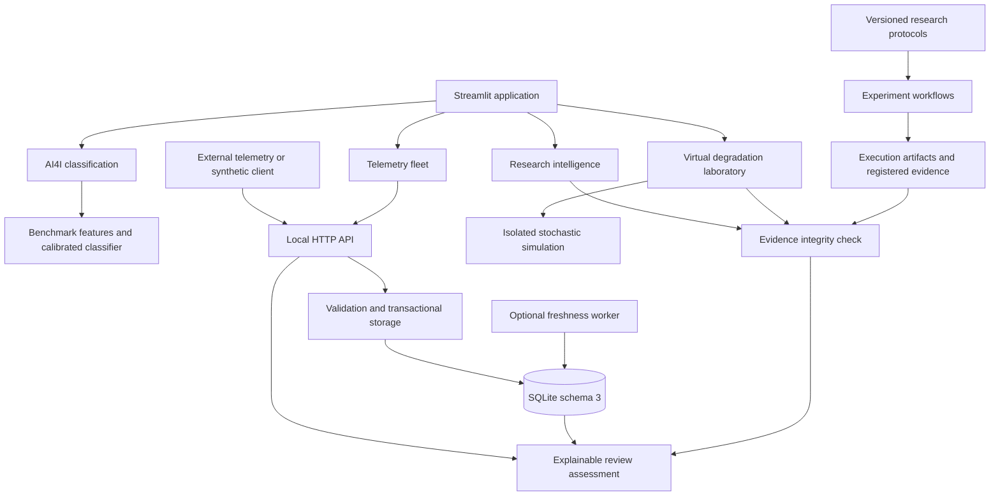

# AERIS architecture

AERIS is a local research platform, not a certified industrial monitoring system. Four application workspaces have distinct data and inference boundaries.

## Responsibilities

| Module | Responsibility |
|---|---|
| app.py | Workspace routing; AI4I classifier |
| src/evidence_console.py | Nine read-only research pages, measured and simulated replay, technical report |
| src/twin_console.py and src/digital_twin.py | Isolated virtual wear and paired maintenance simulation; separate verified measured-signal and sensitivity context |
| src/api.py and src/telemetry_contract.py | Local HTTP interface, bounded requests, canonical units and optional shared bearer token |
| src/telemetry_store.py and src/monitoring.py | SQLite transactions, asset registry, deduplication, monitoring policy and events |
| src/incidents.py and src/monitor_worker.py | Review lifecycle and optional periodic freshness scan |
| src/anomaly.py and src/decision_engine.py | Causal deviation and explainable review assessment; operational forecasts withheld |
| src/fleet_console.py | Fleet history, event and incident review, advisory export |
| scripts/telemetry_backup.py | Consistent SQLite backup and integrity-checked recovery |
| research/ | Fixed protocols, experiments, ten registered evidence files and generated technical report |

## Trust and deployment boundaries

Docker Compose binds dashboard and API host ports to loopback. The optional monitoring profile shares the API storage volume. The API container uses a read-only root filesystem and an unprivileged user. The dashboard is read-only by default; enabling review actions grants its users the ability to change incident state through the shared service credential. Do not expose it to untrusted users. The API has no TLS, per-user identity, production rate limiting or external notification system.

The manifest verifies Git blob content and byte count; execution revisions provide provenance, not signatures or scientific certification. The read-only research workspace does not train models or fetch raw datasets. AI4I training is deferred. The simulation cannot write asset telemetry, and benchmark calibration does not transfer to registered assets. The decision engine withholds operational RUL and failure probability regardless of whether review rules trigger.

## Validation and change rules

Preserve frozen benchmark outcomes, report negative results and keep units and populations visible. Do not use future observations for online features or select a new primary using observed evaluation outcomes. Regression CI, experiment workflows and browser smoke tests cover separate gates; passing them does not establish field safety or independent validation.

See [quickstart](quickstart.md), [API guide](api.md), [virtual laboratory](digital_twin.md), [research index](../research/README.md) and [roadmap](roadmap.md).
