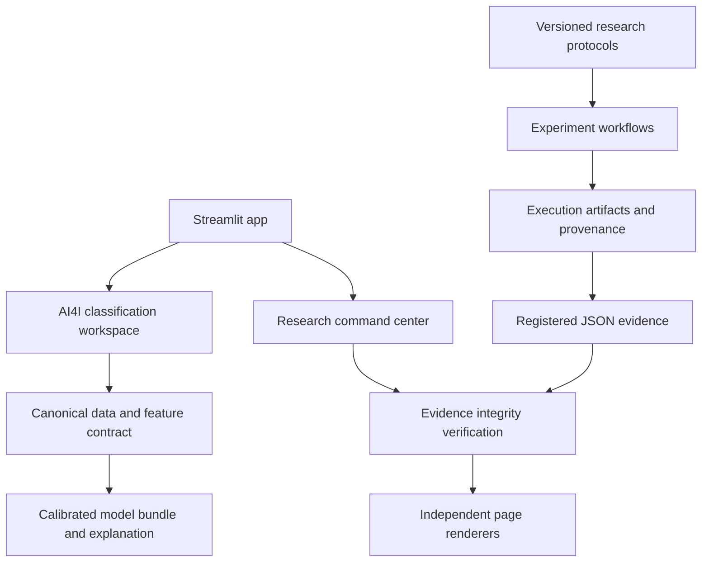

# AERIS architecture

AERIS is a research prototype, not a certified industrial monitoring system. Its application separates synthetic snapshot classification from read-only research evidence.



## Boundaries

- `app.py`: workspace selection and original AI4I interactive classification.
- `src/console_models.py` and feature/data modules: canonical model preparation. The research console does not fit models or fetch datasets.
- `src/evidence_console.py`: distinct render functions for overview, maintenance, official benchmark, telemetry replay, physical bearings, adaptive reliability and independent replication and technical report. The overview computes metrics from evidence rather than manually copying headline numbers.
- `research/`: experiment definitions, fixed protocols, reports and evidence verification. Development and independent/official evaluation tasks are separated.
- `research/evidence/`: seven registered reports. The manifest verifies Git blob content and byte count; provenance links identify execution revisions. This is not a signature or scientific certification.
- `.github/workflows/`: regression CI and dedicated dataset experiments. Large raw datasets are not committed.

## Change rules

Preserve frozen official and independent evidence; append separately identified experiments rather than rewriting historical outcomes. Never use future lifetime to construct online features or select a policy. Keep units and evaluation populations visible. The review policy rejected all evaluated physical forecasts; the adaptive advantage did not replicate on PRONOSTIA. Neither is a production-ready capability.

## Local validation

```bash
python -m research.verify_evidence
python -m pytest -q
streamlit run app.py
```

The Streamlit theme is native rather than injected CSS. Sidebar navigation renders only the selected page. AI4I training and SHAP imports are deferred until needed; the research console does not train models. The report generator (`python -m research.technical_report --output AERIS_technical_report.md`) verifies registered evidence before constructing a deterministic Markdown report. Actual latency and browser appearance have not yet been measured.
