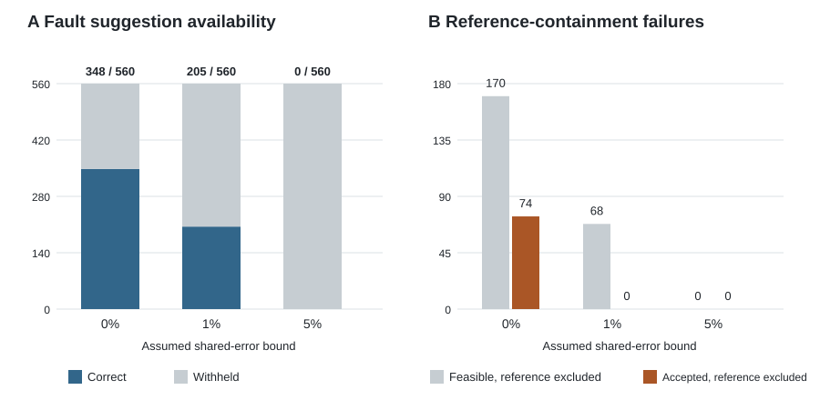
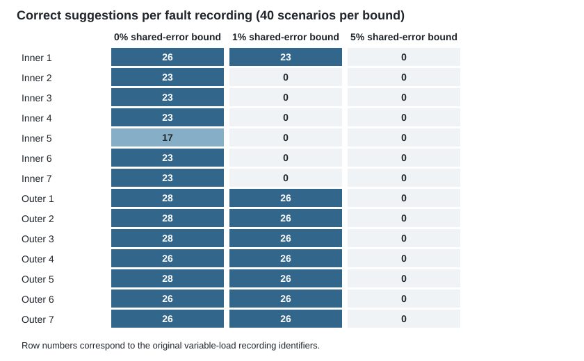
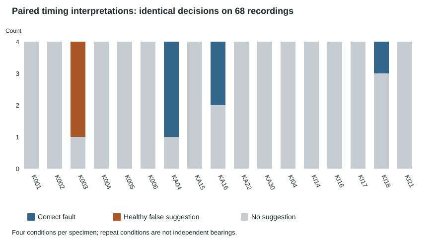

# When sensor agreement is not enough: a bounded-error case study of selective bearing fault diagnosis

**Revised working manuscript v0.2 — not submitted or peer reviewed. Author candidate: Sanket Nichit (ORCID 0009-0000-6993-7561). Author review and approval required.**

## Abstract

Agreement of rotational-speed indications is insufficient to establish the accuracy of a bearing diagnostic reference when measurements share systematic error. This retrospective case study separates reference feasibility, stability of a fixed spectral decision rule, and correctness against benchmark fault labels. We derive the exact scalar feasible-reference set for two indications subject to bounded shared and channel-specific relative errors, and cross-check the derivation by independent exact-rational polygon projection. On 17 previously observed MFPT recordings, 120 artificial metadata-error scenarios yield 2,040 repeated recording-scenario comparisons. Increasing the assumed shared-error bound from 0 to 1% removes 74 observed accepted suggestions whose feasible sets exclude the benchmark reference, while correct fault suggestions decline from 348 to 205 of 560 per bound. At 5%, every fault suggestion is withheld. A separate conditional Paderborn transfer case yields identical suggestions or abstentions under two timing interpretations for all 68 recordings from 17 specimens, yet identifies only six of 44 damaged recordings correctly and suggests faults on three of 24 healthy recordings. These outcomes illustrate the distinction between consistency and diagnostic validity; neither establishes calibration, operational safety, or generalizable error rates. All experiments use frozen archived procedures and previously observed outcomes. The software and registered evidence are available through AERIS v0.2.0.

**Keywords:** bearing fault diagnosis; common-mode error; bounded uncertainty; selective diagnosis; reference containment; reproducibility.

## 1. Introduction

Characteristic bearing fault frequencies depend on rotation speed and geometry. A speed reference that is incorrectly specified can move the expected spectral windows relative to observed peaks, changing the ranking of candidate faults. Envelope analysis provides a conventional route to extracting repetitive fault-related components [1]. Yet a diagnostic rule that consistently returns the same decision is not necessarily reliable if its reference assumptions are wrong. An additional speed indication may reduce uncertainty when its errors are genuinely bounded, but it can also appear to corroborate an incorrect reference when the indications share error.

Metrological compatibility and correlated measurement uncertainty are established concepts [2,3]. Set-membership estimation has long studied consistency under bounded correlated errors [4]. Selective classification likewise formalizes the trade-off between prediction availability and error [5]. Recent bearing studies explicitly investigate rotational-speed uncertainty and selective diagnosis under speed and source shifts [6,7]. We therefore make no first-method claim for these concepts. Siddique et al. [6] already combine physical screening with calibration and unit-disjoint evaluation, including external transfer. Zhao et al. [7] separate support eligibility and selective acceptance under shift. Our experiments neither reproduce their methods nor provide a matched comparison. Studies of bearing-data leakage [11,12] also motivate keeping recording and specimen identities explicit. The narrower objective is to examine their interaction in a fixed, auditable diagnostic rule, separating three questions: (i) is an assumed reference compatible with the measurement model; (ii) does the decision remain invariant over the compatible reference set; and (iii) does the suggestion match the recorded fault label? The paper uses two distinct retrospective examples to demonstrate why these questions must not be conflated.

## 2. Bounded shared-error model

Let strictly positive P and S be speed indications and R an unknown positive reference. The model is P=R(1+c+e1), S=R(1+c+e2), where the relative shared error c and individual errors e1 and e2 satisfy |c|<=C, |e1|<=A, and |e2|<=B. These are deterministic assumed bounds, not standard uncertainties or estimated probabilities. Assume A+C<1 and B+C<1. Define t=R/P and q=S/P.

For any t>0 the common error must simultaneously lie in [-C,C], [1/t-1-A,1/t-1+A], and [q/t-1-B,q/t-1+B]. Three closed intervals intersect if and only if every pair intersects. Consequently, define L=max{1/(1+A+C), q/(1+B+C)} and U=min{1/(1-A-C), q/(1-B-C)}. If A+B>0, the feasible set is [max{L, |q-1|/(A+B)}, U] when the lower endpoint does not exceed U, and empty otherwise. For A+B=0, q=1 is necessary, and [L,U] is feasible if nonempty. This is necessary and sufficient in exact real arithmetic.

If the true errors satisfy the stated bounds, the reference belongs to this set. The converse does not hold: a nonempty set merely asserts existence of a model-compatible reference. For example, P=S=1530 rpm is compatible with both R=1530 and zero shared error, and R=1500 with a +2% shared error and zero individual errors. Assuming A=B=0.005 and C=0.01 yields a nonempty interval that excludes 1500 rpm. No amount of equality between these two indications alone distinguishes those alternatives.

A separate exact-rational check projects the feasible polygon in variables t and y=tc, enumerating intersections of its linear inequality boundaries. Across 3,060 combinations, all 1,658 feasible and 1,402 infeasible cases agree with the formula. This is computational corroboration of the derivation, not a proof of floating-point implementation correctness or physical calibration.

## 3. Fixed diagnostic procedure and experimental design

### 3.1 Point rule and interval guard

The archived CWRU development rule uses median envelope-band power fractions for three candidate orders (inner, outer, twice ball spin). The MFPT transfer procedure resamples to 12 kHz, normalizes each of the first four 8,192-sample windows, applies a fourth-order 2–5 kHz bandpass and the Hilbert-envelope transform, then sums spectral power in the union of tolerance bands around the first three harmonics of each candidate center. The half-width is two frequency bins (2*12000/8192 Hz). Fractions are normalized by total spectral power, then aggregated by the median over windows. The winner must be unique, the top score must exceed 0.00974446327636002, and the relative margin (top-second)/top must be at least 0.8. Otherwise the rule withholds a suggestion. Thresholds are inherited from the archived CWRU development procedure; no tuning on the results below occurred.

The reference feasibility set defines a scale range for the fixed spectrum. Guaranteed and possible harmonic-bin masks bound score fractions over that range. The archived implementation first attempts a global sufficient test, then partitions at bin-membership crossing points and bisects regions, examining closed cells with conservative numerical slack. It accepts only when the same non-abstaining winner is established throughout all checked cells. Exceeding the 4,096-cell complexity budget produces abstention. Floating-point precautions are not formal interval arithmetic. Agreement of this algorithm's output establishes neither the validity of the underlying reference assumptions nor correspondence to the physical defect.

### 3.2 MFPT retrospective common-error audit

The MFPT source [8] contains 17 selected recordings: seven inner-race, seven outer-race and three healthy. The archived nominal metadata indicate 25 Hz shaft frequency; original sampling rates differ by fault and healthy categories (48,828 and 97,656 Hz respectively). Reference centers are approximately 118.875 Hz, 81.125 Hz and 127.82 Hz. Artificial errors change declared reference metadata rather than collecting new physical sensor measurements; the underlying measured spectra are reused.

The crossed scenario grid consists of five primary errors (-5%, -1%, 0, +1%, +5%), two primary bias budgets (1%, 5%, with 0.1% repeatability added), four secondary modes (reference aligned, +0.5% offset, shared primary bias, opposed primary bias), and three assumed common-error bounds (0, 1%, 5%). The secondary individual bound is 0.5% (0.1% repeatability plus 0.4% bias). Shared bias is injected as the common component in the shared-bias mode only; otherwise it is zero in the modeled decomposition. Each bound has 40 scenarios, 560 fault assessments and 120 healthy assessments. The zero-common results reproduce the earlier frozen fusion outcomes. The benchmark reference is a metadata reference, not a calibrated tachometer standard. No inference about empirical sensor accuracy follows.

For a fixed bound let Nf be the number of damaged-record assessments, A the number of non-null suggestions on those assessments, E the number of those suggestions with an incorrect label, and Nh the number of healthy-record assessments. Fault coverage is A/Nf; retained fault-label error is E/A (undefined for A=0); the healthy false-suggestion fraction is the number of non-null healthy suggestions divided by Nh. These are descriptive grid fractions, not population error probabilities. We also count nonempty sets excluding the benchmark reference and accepted suggestions whose sets exclude it. The latter is an assumption/containment failure, not synonymous with an incorrect fault label. Repeated scenarios are not independent observations; no binomial confidence intervals or independent-sample significance tests are applied.

### 3.3 Separate conditional transfer study

Paderborn KAt-DataCenter [9] supplies a primary cohort of six healthy bearings, five accelerated outer-race damaged bearings and six accelerated inner-race damaged bearings. Repetition 1 is used under four operating conditions, giving 68 recordings; 56 lie outside the earlier structural pilot. The method uses specimen-specific text-extracted geometry candidates (eight rolling elements, 6.75 mm element diameter, 28.55 or 29.05 mm pitch diameter and zero angle) and nominal speed 900 or 1,500 rpm. Geometry was not visually verified and the physical sampling clock was not calibrated.

Two preprocessing hypotheses are compared: nominal uniform indexing at 64 kHz, and treating the stored HostService timestamp as the sample instant followed by linear interpolation within the observed time span onto a 64 kHz grid. Both are resampled to 12 kHz and use the same four-window spectral rule and unchanged threshold. Invalid or insufficient preprocessing is withheld rather than imputed. The two paths are paired interpretations of the same recordings, not measurements from independent sensors. This case does not test the shared-error model directly.

### 3.4 Evidence audit

The complete result ZIPs from the archived MFPT and Paderborn workflow runs were retrieved and matched against the SHA-256 values registered in the v0.2.0 evidence summaries. Their summary data, excluding the record-level rows, match the registered archive. All 120 MFPT scenario identities and the 17 source record labels were checked, and counts were reconstructed from the 2,040 decisions and interval endpoints. The 68 Paderborn recording names and fingerprints are unique within the selected artifact; decisions, paired agreement, specimen and condition counts were inspected. This audit reaggregates existing results without running new diagnostic experiments or independently verifying the raw waveform bytes.

## 4. Results

### 4.1 Common-error bound and coverage

| Assumed C | Correct fault | Wrong fault | Fault abstentions | Healthy false | Feasible but reference excluded | Accepted but reference excluded |
|---|---:|---:|---:|---:|---:|---:|
| 0% | 348 | 0 | 212 | 0 | 170 | 74 |
| 1% | 205 | 0 | 355 | 0 | 68 | 0 |
| 5% | 0 | 0 | 560 | 0 | 0 | 0 |

Each row contains 560 fault and 120 healthy assessments. At C=0, 348/560 (62.1%) fault assessments are correctly accepted; at C=1% this declines to 205/560 (36.6%). At C=5%, coverage is zero and retained error is undefined. Across the 72 scenarios with valid declared decompositions, all 1,224 repeated record comparisons contain the benchmark reference. Nevertheless, 68 compatible sets at C=1% exclude that reference under invalid assumptions. A nonempty intersection cannot substitute for independently justified bounds. A paired reaggregation of the same 680 recording-scenario identities across C=0 and C=1% gives 205 accepted at both bounds, 143 accepted only at zero, zero accepted only at 1%, and 332 withheld at both. The 143 losses include the 74 zero-bound acceptances excluding the benchmark reference. At C=5% the remaining 205 suggestions are withheld. This observed nesting of accepted identities is specific to the tested grid.

*Figure 1. Correct suggestions and withheld fault assessments (A); reference-containment failures across all 680 comparisons per bound (B). Accepted-without-reference is a subset of feasible-without-reference. Different panel denominators are intentional.*

### 4.2 Recording-level heterogeneity

Reaggregation of the individual decisions reveals uneven availability. At C=0, the seven inner recordings contribute 158 correct suggestions and the seven outer recordings 190, out of 280 assessments per category. At C=1%, inner contributions fall to 23/280 (8.2%), all on one recording, while outer contributions total 182/280 (65.0%) across all seven outer recordings. This post hoc descriptive analysis indicates that a pooled risk-coverage number can conceal category-dependent rejection. It is not an independent demonstration of systematic differences between physical fault types.

*Figure 2. Correct accepted suggestions for each fault recording out of 40 repeated scenarios per bound. Row order follows source identifiers; seven inner and seven outer variable-load recordings. No recording is treated as 40 independent assets.*

### 4.3 Timing agreement and Paderborn transfer

Both timing interpretations give identical decisions on 68/68 recordings: nine identical accepted suggestions and 59 paired abstentions. Each interpretation correctly suggests a fault in 6/44 damaged recordings (13.6%), abstains on 38, and yields three false suggestions among 24 healthy recordings (12.5%). Wrong accepted damaged suggestions are zero. On the 56 nonpilot recordings, only 3/36 damaged recordings receive correct suggestions and 3/20 healthy recordings receive false suggestions. All healthy false suggestions occur on K003 in three conditions. Only three of eleven damaged specimens ever receive a correct suggestion. The 900 rpm condition yields 17 abstentions. Despite the decision agreement, the reported relative L2 waveform difference spans approximately 0.00583 to 1.3893; identical decisions do not establish waveform equivalence or identify the true sample clock.

*Figure 3. Decisions aggregated by specimen, four conditions per specimen; blue indicates correct fault suggestion, rust indicates healthy false suggestion, gray indicates no suggestion. Both timing interpretations have the same decisions. No suggestion is not a healthy diagnosis.*

## 5. Discussion

The mathematical model identifies a feasible-reference set conditional on assumed deterministic error limits. It exposes an important logical separation: compatible indications imply existence of a reference under the model; acceptance over that set implies a stable rule output under the modeled perturbations; matching the benchmark label is an empirical observation about the assessed recording. None implies the other without additional assumptions. The MFPT audit illustrates the availability cost of conservative shared-error bounds and the persistence of nonempty misleading sets when those bounds are invalid. The Paderborn case illustrates a distinct issue: stable decisions under competing preprocessing interpretations may coexist with poor transfer. Combining the two cases does not establish that common-mode bias caused the Paderborn results.

The model is not a substitute for traceable calibration. The original spectral rule ignores many factors that can influence envelope spectra, including slip, variable-speed motion and measurement-chain effects. A shared-error bound must be independently justified for the relevant instruments, environment and operating regimes. A conservative guard can withhold useful suggestions; a wider bound need not make aggregate acceptance monotonically decrease for arbitrary scenario grids because previously infeasible cases can become feasible. A practical system needs explicit unavailable, conflict and uncertain states, and must not convert abstention into a normal diagnosis.

The study is a retrospective methodological case study rather than a new general set-membership theory or state-of-the-art bearing classifier. The exact scalar projection is a compact specialization of bounded-error estimation, and the literature already describes speed-uncertain diagnosis and selective cross-source methods. A matched empirical comparison with those methods was not conducted. The main contribution under consideration is the evidence-linked separation of reference feasibility, decision invariance and label correctness, illustrated with negative results and explicit denominators.

## 6. Limitations and next scientific validation

The 2,040 MFPT comparisons reuse 17 recordings and the metadata perturbations are hypothetical. The Paderborn conditions reuse physical specimens; the 56 nonpilot recordings do not constitute a wholly unseen independent cohort. All outcomes were previously observed; the recording-level breakdown was exploratory. No claims of independent statistical replication, field accuracy or probabilistic coverage are supported. The actual ADC clock, geometry and common-error bounds are unverified. The numerical guard is not certified interval arithmetic. Geometry-related and variable-speed uncertainties are not included in the scalar theorem. No operational advice or industrial safety claim is made.

A future confirmatory study would require traceably calibrated synchronized reference measurements, independently frozen bounds and thresholds, genuinely unseen physical bearings, specimen-aware sampling and reporting, and an explicit treatment of healthy false suggestions and abstention. It must be designed separately from this released software scope. No such experiment is claimed here.

## 7. Conclusion

Sensor agreement and agreement of diagnostic outputs cannot establish measurement validity by themselves. Under a specified bounded shared-error model, reference feasibility is computable and conditional containment follows algebraically. The retrospective MFPT study demonstrates the trade-off between containment failures and availability, while Paderborn illustrates identical decisions despite low coverage and healthy false suggestions. The findings support transparent reporting of measurement assumptions, abstention and external validity limits, not a general claim of calibrated diagnostic performance.

## Data and code availability

The exact software release is AERIS v0.2.0 [10], accepted revision 5e6aba8f01f0a35347698c4c45661b09db7a92ca. Its evidence summaries, frozen protocols, code and checksum manifest are public. The complete MFPT artifact 15020404150 and Paderborn artifact 15022373895 are linked from the registered summaries and may expire; source data are not redistributed here. The manuscript workspace includes a mathematical checker, recording-level aggregation audit and vector figures. MFPT is attributed to Eric Bechhoefer and the pinned MathWorks redistribution (CC BY-NC-SA 4.0); Paderborn is attributed to Christian Lessmeier et al., Chair of Design and Drive Technology, Paderborn University, KAt-DataCenter (CC BY-NC 4.0). Original software is MIT licensed; third-party terms continue to apply. Confirm redistribution permissions for derived materials before manuscript release.

## Declarations (author review required)

Draft prepared with substantial AI assistance; human author must independently review claims, equations, references, contribution statements, affiliations, funding and conflict-of-interest declarations before submission. No funding, conflict, approval or authorship declaration is invented. No journal or preprint submission has been made.

## References

1. Randall, R. B., and Antoni, J. (2011). Rolling element bearing diagnostics—A tutorial. Mechanical Systems and Signal Processing 25, 485–520. https://doi.org/10.1016/j.ymssp.2010.07.017
2. JCGM (2008). Evaluation of measurement data—Guide to the expression of uncertainty in measurement, JCGM 100:2008. https://doi.org/10.59161/jcgm100-2008e
3. JCGM. International vocabulary of metrology, clause 2.47: Metrological compatibility of measurement results. https://jcgm.bipm.org/vim/en/2.47.html
4. Ragot, J. Guaranteed consistency between measurements and parameter systems with correlated additive and multiplicative uncertainties (2022). Complex Engineering Systems 2, 10. https://doi.org/10.20517/ces.2022.13
5. El-Yaniv, R., and Wiener, Y. (2010). On the Foundations of Noise-free Selective Classification. JMLR 11, 1605–1641. https://jmlr.csail.mit.edu/papers/v11/el-yaniv10a.html
6. Siddique, M. F., Wisal, M., Umar, M., Ali, S., Janjua, M. M., Khalid, H. M., Haneef, Z., and Akhtar, N. A Physics-Guided Statistical Framework for Bearing Fault Diagnosis Under Unit Variability and Rotational Speed Uncertainty (2026). Machines 14, 1140. https://doi.org/10.3390/machines14101140
7. Zhao, B., Shan, D., Lou, C., Hu, Z., Zhu, T., and Zhang, F. Support-Bounded Confidence-First Selective Diagnosis of Bearing Faults Under Speed and Source Shifts (2026). Processes 14, 3325. https://doi.org/10.3390/pr14203325
8. Bechhoefer, E. (2013). Condition Based Maintenance Fault Database for Testing Diagnostics and Prognostic Algorithms. Pinned MathWorks redistribution: https://github.com/mathworks/RollingElementBearingFaultDiagnosis-Data/tree/d3efefb6ce84fa1ee6c0311f80f7c89cf903ad1d
9. Lessmeier, C., Kimotho, J. K., Zimmer, D., and Sextro, W. (2016). Condition Monitoring of Bearing Damage in Electromechanical Drive Systems by Using Motor Current Signals of Electric Motors: A Benchmark Data Set for Data-Driven Classification. PHM Society European Conference 3(1). https://doi.org/10.36001/phme.2016.v3i1.1577 ; dataset https://mb.uni-paderborn.de/en/kat/research/bearing-datacenter
10. Nichit, S. (2026). AERIS: Machine Health Intelligence (Version 0.2.0) [Computer software]. Zenodo. https://doi.org/10.5281/zenodo.24533914

11. Wheat, L., von Mohrenschildt, M., Habibi, S., and Al-Ani, D. (2024). Impact of Data Leakage in Vibration Signals Used for Bearing Fault Diagnosis. IEEE Access. https://doi.org/10.1109/ACCESS.2024.3497716
12. Vieira, J. P., Bauler, V. A., Rosa, R. K., and Silva, D. (2026). Towards a more realistic evaluation of machine learning models for bearing fault diagnosis. Mechanical Systems and Signal Processing. https://doi.org/10.1016/j.ymssp.2026.114640

Reference metadata and related-work coverage remain subject to complete citation-chain and expert review before submission.
